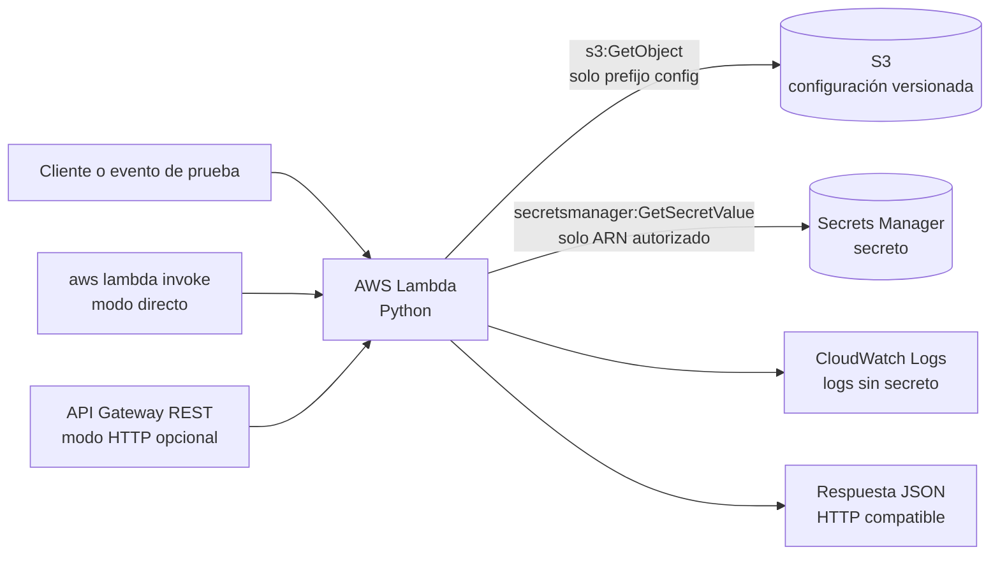
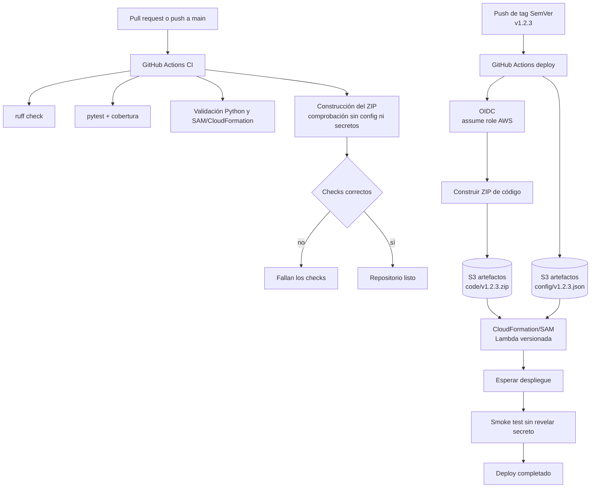
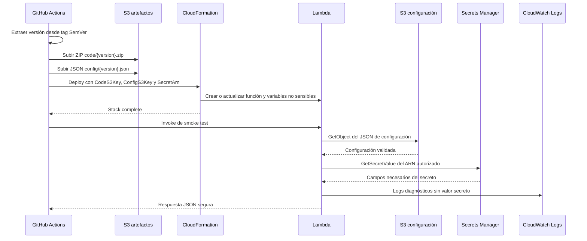

# Lambda CI/CD con GitHub Actions

Repositorio pequeño y publicable que demuestra una integración continua y un despliegue
versionado de una función AWS Lambda en Python. La solución separa deliberadamente tres
cosas:

- **Código**: ZIP reproducible con la Lambda y sus dependencias.
- **Configuración**: JSON no sensible, independiente y versionado en Amazon S3.
- **Secreto**: valor únicamente en AWS Secrets Manager; nunca se empaqueta ni se imprime.

La carpeta del repositorio conserva el nombre histórico `lamda-cicd`, pero los recursos,
identificadores y documentación usan `lambda` correctamente.

## Arquitectura

La Lambda recibe un evento directo o HTTP compatible con API Gateway, carga el JSON de
configuración desde S3 y obtiene de Secrets Manager solo los campos necesarios para construir
una respuesta segura. El valor secreto nunca forma parte de la respuesta ni de los logs.

Hay dos modos de ejecución, seleccionables en cada despliegue:

- **Directo, sin API Gateway**: `EnableApiGateway=false`. Se usa `aws lambda invoke`, es el
  modo por defecto y no añade un endpoint público.
- **HTTP con API Gateway**: `EnableApiGateway=true`. Crea una API REST regional con una ruta
  `ANY /` sobre la raíz, autorización `NONE` para este ejemplo y permiso
  restringido a invocar esta función. La URL queda en el output `ApiGatewayUrl`.

Ambos modos llaman a la misma función, el mismo ZIP y la misma lógica de negocio; solo cambia
el adaptador de entrada.



### Flujo CI/CD



### Secuencia de despliegue y ejecución



## Estructura

```text
lamda-cicd/
├── .github/workflows/
│   ├── ci.yml                 # Validación en pull requests y pushes a main
│   └── deploy.yml             # Deploy exclusivo de tags SemVer mediante OIDC
├── src/app/
│   ├── handler.py             # Entrada Lambda y respuesta HTTP
│   ├── config.py              # Lectura y validación de S3
│   └── secrets.py             # Lectura aislada de Secrets Manager
├── tests/                     # Tests sin llamadas reales a AWS
├── infrastructure/
│   ├── template.yaml          # Lambda, role y permisos de ejecución
│   └── bootstrap.yaml         # OIDC, role GitHub, bucket y secreto opcional
├── config/example.json        # Forma de configuración, sin datos sensibles
├── scripts/                   # Bootstrap, empaquetado, upload y smoke test
├── requirements.txt
├── requirements-dev.txt
├── pyproject.toml
├── Makefile
├── SECURITY.md
└── README.md
```

## Prerrequisitos locales

- Python 3.12 y `pip`.
- AWS CLI configurada solo cuando se ejecuten acciones explícitas contra AWS.
- `jq`, `zip` y Bash para los scripts.
- AWS SAM CLI para validar o desplegar la plantilla.
- Docker es opcional, según la estrategia local de empaquetado.

Crear un entorno virtual local:

```bash
python3.12 -m venv .venv
source .venv/bin/activate
python -m pip install --upgrade pip
python -m pip install -r requirements-dev.txt
```

## Configuración inicial de AWS

La preparación se ejecuta una vez y **no la realiza automáticamente GitHub Actions**. El
bootstrap debe crear o dejar preparados:

1. Un bucket privado de artefactos con bloqueo de acceso público, versionado y cifrado SSE-S3.
2. Un secreto de Secrets Manager con un nombre estable y un valor generado fuera del repositorio.
3. Un proveedor OIDC de GitHub y un role separado para GitHub Actions.
4. Las restricciones de trust policy al repositorio concreto y al patrón de tags autorizado.

Revisar primero los parámetros y ejecutar explícitamente:

```bash
export AWS_REGION=eu-west-1
export GITHUB_OWNER=tu-organizacion
export GITHUB_REPOSITORY=tu-organizacion/lamda-cicd
./scripts/bootstrap.sh
```

El script debe ser idempotente y no aceptar secretos por argumentos que puedan quedar en el
historial del shell. El role de GitHub puede subir artefactos y operar la stack; el role de
Lambda solo puede leer el prefijo de configuración y el ARN concreto del secreto.

No se deben crear recursos reales durante una validación local. Los comandos de bootstrap,
`sam deploy`, `aws cloudformation` y cualquier recurso con coste requieren una acción explícita
del usuario.

## Configuración JSON

`config/example.json` documenta la forma mínima. La configuración se sube separada del ZIP,
por ejemplo:

```json
{
  "application_name": "lambda-cicd-demo",
  "environment": "production",
  "message": "respuesta desde configuración versionada"
}
```

El objeto debe contener campos no sensibles y pasar la validación de `config.py`. Para cambiar
la configuración no es necesario reconstruir el código: se sube un nuevo objeto versionado y se
actualiza `ConfigS3Key` en el siguiente despliegue.

## Comandos locales

```bash
make lint
make test
make validate
make package
```

Equivalentes directos:

```bash
ruff check .
python -m pytest
python -m compileall src tests
sam validate --lint --template-file infrastructure/template.yaml
./scripts/package.sh v0.0.0
```

El paquete se inspecciona antes de publicarlo. No debe contener `config/`, `.env`, secretos,
tests, caches ni artefactos de desarrollo.

## Elegir el modo de invocación

El modo se decide con el parámetro `EnableApiGateway` de CloudFormation. Para desplegar sin
API Gateway:

```bash
aws cloudformation deploy \
  --stack-name "$STACK_NAME" \
  --template-file infrastructure/template.yaml \
  --capabilities CAPABILITY_NAMED_IAM \
  --parameter-overrides \
    CodeS3Bucket="$ARTIFACT_BUCKET" \
    CodeS3Key="code/1.2.3.zip" \
    ConfigS3Bucket="$ARTIFACT_BUCKET" \
    ConfigS3Key="config/1.2.3.json" \
    SecretArn="$SECRET_ARN" \
    EnableApiGateway=false
```

Para desplegar con API Gateway, usa los mismos parámetros y cambia el modo:

```bash
aws cloudformation deploy \
  --stack-name "$STACK_NAME" \
  --template-file infrastructure/template.yaml \
  --capabilities CAPABILITY_NAMED_IAM \
  --parameter-overrides \
    CodeS3Bucket="$ARTIFACT_BUCKET" \
    CodeS3Key="code/1.2.3.zip" \
    ConfigS3Bucket="$ARTIFACT_BUCKET" \
    ConfigS3Key="config/1.2.3.json" \
    SecretArn="$SECRET_ARN" \
    EnableApiGateway=true \
    ApiStageName=v1
```

El workflow de deploy toma `ENABLE_API_GATEWAY` desde una variable del repositorio de GitHub;
si no existe, usa `false`. Después del despliegue lee `ApiGatewayUrl` y el smoke test usa
automáticamente HTTP cuando ese output existe. Para el modo directo usa el output
`FunctionName`.

## Workflows

### CI: `ci.yml`

Se ejecuta en pull requests y en pushes a `main`. Fija la versión de Python, instala las
dependencias con ficheros versionados, ejecuta `ruff`, `pytest`, la compilación sintáctica, la
validación de infraestructura y la comprobación del ZIP.

### Deploy: `deploy.yml`

Solo responde a tags que cumplan SemVer, como `v1.2.3`. El workflow:

1. Extrae la versión del tag.
2. Usa `aws-actions/configure-aws-credentials` con OIDC, sin access keys estáticas.
3. Construye el ZIP del código.
4. Sube `code/v1.2.3.zip` y `config/v1.2.3.json` a claves distintas.
5. Despliega CloudFormation/SAM pasando ambas ubicaciones y `SecretArn`.
6. Espera a que termine la stack.
7. Ejecuta un smoke test que valida la forma de la respuesta, pero no muestra el secreto.

Sus permisos de job se limitan a `contents: read` e `id-token: write`.

Publicar una versión:

```bash
git tag v1.2.3
git push origin v1.2.3
```

## Prueba segura

Para probar la Lambda directamente, usa un evento sintético sin credenciales ni valores
secretos:

```bash
AWS_REGION="$AWS_REGION" \
FUNCTION_NAME="$LAMBDA_FUNCTION_NAME" \
./scripts/smoke-test.sh
```

Para probar el modo HTTP, exporta la URL del output de CloudFormation. El script no necesita
credenciales de aplicación porque la API de este ejemplo es pública:

```bash
AWS_REGION="$AWS_REGION" \
FUNCTION_NAME="$LAMBDA_FUNCTION_NAME" \
API_URL="$API_GATEWAY_URL" \
./scripts/smoke-test.sh
```

La respuesta HTTP es el mismo JSON que devuelve la invocación directa. Si se necesita
autenticación real, sustituye `AuthorizationType: NONE` por un authorizer antes de publicar.

La respuesta puede incluir el nombre de la aplicación, el entorno y un estado derivado, pero
nunca el valor del secreto. Los logs deben permitir distinguir errores de configuración,
secreto y dependencia sin registrar payloads sensibles.

## Rollback

Un rollback consiste en volver a desplegar un tag anterior, por ejemplo:

```bash
git push origin v1.2.2
```

El workflow volverá a subir el ZIP y la configuración asociada a `v1.2.2` y actualizará la
stack. Las versiones antiguas de S3 se conservan para facilitar la recuperación. La limpieza
de versiones debe hacerse con una política de lifecycle revisada y nunca debe borrar la versión
activa.

## Limpieza

La eliminación es explícita y debe revisarse antes de ejecutarse:

```bash
./scripts/cleanup.sh
```

Debe retirar la stack, el role y el proveedor OIDC solo si ya no los usa ningún repositorio,
y el bucket solo después de decidir qué versiones históricas se conservan. Secrets Manager
puede mantener una ventana de recuperación; comprobarla antes de considerar la limpieza
completa.

## Troubleshooting

- **OIDC o `AccessDenied`**: revisar `permissions`, el issuer `token.actions.githubusercontent.com`,
  `aud` igual a `sts.amazonaws.com` y la condición `sub` del repositorio/tag.
- **S3 `AccessDenied`**: comprobar región, bucket, prefijo autorizado y que la key enviada a
  CloudFormation coincide exactamente con el objeto versionado.
- **Secrets Manager `AccessDenied`**: revisar el ARN exacto del secreto y la policy del role de
  ejecución, no la del role de GitHub.
- **CloudFormation `CREATE_FAILED`**: consultar eventos de la stack y confirmar que el ZIP,
  los parámetros y el role existen antes de reintentar.
- **Smoke test fallido**: revisar CloudWatch Logs y las variables de entorno no sensibles; no
  imprimir el secreto para diagnosticar.
- **ZIP contaminado**: ejecutar el verificador del empaquetado y eliminar el directorio de
  trabajo generado antes de volver a construir.

## Seguridad y límites

Consulta [SECURITY.md](SECURITY.md) para reportar secretos, rotarlos y revocar el role OIDC.
La solución usa SSE-S3 por simplicidad operativa; SSE-KMS es una mejora razonable si se necesita
control de claves y auditoría adicional, con permisos KMS explícitos.

Quedan fuera del ejemplo la creación automática del proveedor OIDC, la rotación programada del
secreto, los despliegues multi-región y la promoción entre cuentas. Esas capacidades deben
incorporarse sin ampliar innecesariamente los permisos de la Lambda.
