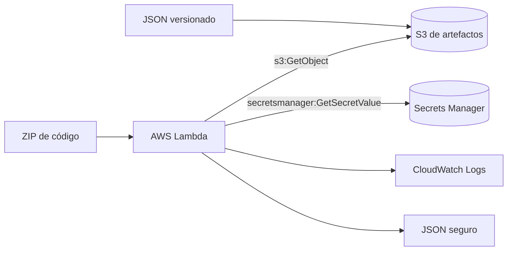

# Lambda CI/CD

Repositorio de referencia para construir, probar y desplegar una función AWS Lambda en Python
separando código, configuración y secretos.

La solución mantiene la misma Lambda en cuatro formas de exposición. Cada forma tiene su propio
CloudFormation template, workflow y guía:

| Tipo | Template | Workflow | Guía |
|---|---|---|---|
| Directo | [`template-direct.yaml`](infrastructure/template-direct.yaml) | [`deploy-direct.yml`](.github/workflows/deploy-direct.yml) | [`docs/deploy-direct.md`](docs/deploy-direct.md) |
| API Gateway | [`template-api-gateway.yaml`](infrastructure/template-api-gateway.yaml) | [`deploy-api-gateway.yml`](.github/workflows/deploy-api-gateway.yml) | [`docs/deploy-api-gateway.md`](docs/deploy-api-gateway.md) |
| Application Load Balancer | [`template-alb.yaml`](infrastructure/template-alb.yaml) | [`deploy-alb.yml`](.github/workflows/deploy-alb.yml) | [`docs/deploy-alb.md`](docs/deploy-alb.md) |
| Lambda Function URL | [`template-function-url.yaml`](infrastructure/template-function-url.yaml) | [`deploy-function-url.yml`](.github/workflows/deploy-function-url.yml) | [`docs/deploy-function-url.md`](docs/deploy-function-url.md) |

## Qué hace la aplicación

La Lambda recibe un evento, lee configuración no sensible desde S3 y consulta un secreto en
Secrets Manager. Devuelve JSON compatible con invocación directa, API Gateway, ALB y Function
URL. El valor del secreto no entra en la respuesta, el ZIP ni los logs.

La única diferencia entre los cuatro despliegues es el adaptador de entrada. El código de negocio,
los tests, el bucket de artefactos y el modelo de permisos de ejecución son comunes.

## Artefactos y S3

Cada despliegue utiliza **un único bucket S3 de artefactos**, con dos objetos versionados:

```text
s3://<artifact-bucket>/code/1.2.3.zip
s3://<artifact-bucket>/config/1.2.3.json
```

El despliegue directo no necesita API Gateway, ALB ni Function URL, pero sigue necesitando ambos
objetos: Lambda obtiene el código del ZIP y la aplicación obtiene la configuración desde S3.
Son dos objetos del mismo bucket, no dos buckets ni un único ZIP con configuración embebida.

El secreto vive exclusivamente en Secrets Manager. No se sube al bucket ni se pasa como variable
de GitHub Actions.

Los workflows escriben con `aws s3 cp` usando `--sse AES256`. El bucket creado por el bootstrap
usa versionado, bloqueo de acceso público y una bucket policy que exige HTTPS y rechaza objetos
sin SSE-S3. El role OIDC solo puede escribir bajo los prefijos `code/*` y `config/*`.

## Arquitectura común



## Estructura

```text
lamda-cicd/
├── .github/workflows/
│   ├── ci.yml
│   ├── deploy-direct.yml
│   ├── deploy-api-gateway.yml
│   ├── deploy-alb.yml
│   └── deploy-function-url.yml
├── infrastructure/
│   ├── bootstrap.yaml
│   ├── template-direct.yaml
│   ├── template-api-gateway.yaml
│   ├── template-alb.yaml
│   └── template-function-url.yaml
├── docs/
│   ├── deploy-direct.md
│   ├── deploy-api-gateway.md
│   ├── deploy-alb.md
│   └── deploy-function-url.md
├── src/app/
├── tests/
├── config/example.json
├── scripts/
├── SECURITY.md
└── Makefile
```

## Requisitos

- Python 3.12, `pip`, Bash, `zip`, `jq` y `curl`.
- AWS CLI configurada para acciones explícitas en AWS.
- AWS SAM CLI para validar templates.
- Una cuenta AWS con permisos para el bootstrap y el despliegue elegido.
- Un repositorio GitHub con Actions y OIDC habilitado.

Crear el entorno local sin instalar dependencias globalmente:

```bash
python3 -m venv .venv
source .venv/bin/activate
python -m pip install -r requirements-dev.txt
```

## Preparación común de AWS

Ejecuta una vez el bootstrap después de revisar sus parámetros:

```bash
export AWS_REGION=eu-west-1
export GITHUB_OWNER=tu-organizacion
export GITHUB_REPOSITORY=tu-organizacion/lamda-cicd
export GITHUB_ORGANIZATION_ID=203402347
export GITHUB_REPOSITORY_ID=1417192239
./scripts/bootstrap.sh
```

El bootstrap crea el bucket privado versionado, el secreto y el role OIDC de GitHub. No crea
ningún endpoint de exposición. Cada guía específica indica sus variables, tag y template.

Los workflows usan nombres de función distintos por defecto para que las cuatro variantes
puedan coexistir. Puedes sobreescribirlos con las variables `FUNCTION_NAME_DIRECT`,
`FUNCTION_NAME_API_GATEWAY`, `FUNCTION_NAME_ALB` y `FUNCTION_NAME_FUNCTION_URL`.

No se ejecutan despliegues AWS durante las validaciones locales.

## Configuración de GitHub Actions

Sí, hay que configurar variables en el repositorio de GitHub antes de publicar un tag. El
workflow no usa access keys: obtiene credenciales mediante OIDC asumiendo el role
`GitHubRoleArn` creado por el bootstrap.

En GitHub abre **Settings → Secrets and variables → Actions → Variables** y crea estas
variables de repositorio:

| Variable | Valor | Uso |
|---|---|---|
| `AWS_REGION` | `eu-west-1` | Región del despliegue |
| `ARTIFACT_BUCKET` | output `ArtifactBucketName` | Bucket común de ZIP y configuración |
| `SECRET_ARN` | output `SecretArn` | ARN del secreto, no su valor |
| `AWS_ROLE_ARN` | output `GitHubRoleArn` | Role que asume Actions mediante OIDC |

Variables opcionales generales:

| Variable | Default |
|---|---|
| `FUNCTION_NAME_DIRECT` | `lambda-cicd-direct` |
| `FUNCTION_NAME_API_GATEWAY` | `lambda-cicd-api-gateway` |
| `FUNCTION_NAME_ALB` | `lambda-cicd-alb` |
| `FUNCTION_NAME_FUNCTION_URL` | `lambda-cicd-function-url` |
| `STACK_NAME_DIRECT` | `lambda-cicd-direct` |
| `STACK_NAME_API_GATEWAY` | `lambda-cicd-api-gateway` |
| `STACK_NAME_ALB` | `lambda-cicd-alb` |
| `STACK_NAME_FUNCTION_URL` | `lambda-cicd-function-url` |

Variables específicas:

| Workflow | Variables adicionales |
|---|---|
| `deploy-api-gateway.yml` | `API_STAGE_NAME` opcional, default `v1` |
| `deploy-alb.yml` | `ALB_SUBNETS` y `ALB_SECURITY_GROUP_ID`, obligatorias |
| `deploy-function-url.yml` | `FUNCTION_URL_AUTH_TYPE`, default `AWS_IAM` |

No configures el valor del secreto como variable ni como secret de GitHub. La Lambda lo lee de
Secrets Manager usando `SECRET_ARN`.

Si tienes GitHub CLI autenticada, puedes crear las variables comunes así:

```bash
gh variable set AWS_REGION --body "$AWS_REGION"
gh variable set ARTIFACT_BUCKET --body "$ARTIFACT_BUCKET"
gh variable set SECRET_ARN --body "$SECRET_ARN"
gh variable set AWS_ROLE_ARN --body "$AWS_ROLE_ARN"
```

Para el workflow de ALB añade sus valores reales:

```bash
gh variable set ALB_SUBNETS --body "subnet-aaaaaaaa,subnet-bbbbbbbb"
gh variable set ALB_SECURITY_GROUP_ID --body "sg-aaaaaaaa"
```

Después de cambiar el trust policy del bootstrap, vuelve a ejecutar `./scripts/bootstrap.sh`
antes de usar los tags. El role debe aceptar los cuatro sujetos OIDC exactos:
`direct-v*`, `api-v*`, `alb-v*` y `url-v*`.

### Lista de URLs para comprobar objetos creados durante bootstrap

Después de ejecutar el bootstrap, define la región y el nombre de la stack. El siguiente
bloque obtiene los outputs reales sin imprimir el valor del secreto:

```bash
export AWS_REGION=eu-west-1
export BOOTSTRAP_STACK_NAME=lambda-cicd-bootstrap
export SECRET_NAME="${SECRET_NAME:-lambda-cicd/demo}"

export STACK_ID="$(aws cloudformation describe-stacks \
    --region "$AWS_REGION" \
    --stack-name "$BOOTSTRAP_STACK_NAME" \
    --query 'Stacks[0].StackId' \
    --output text)"

export ARTIFACT_BUCKET="$(aws cloudformation describe-stacks \
    --region "$AWS_REGION" \
    --stack-name "$BOOTSTRAP_STACK_NAME" \
    --query 'Stacks[0].Outputs[?OutputKey==`ArtifactBucketName`].OutputValue' \
    --output text)"
export SECRET_ARN="$(aws cloudformation describe-stacks \
    --region "$AWS_REGION" \
    --stack-name "$BOOTSTRAP_STACK_NAME" \
    --query 'Stacks[0].Outputs[?OutputKey==`SecretArn`].OutputValue' \
    --output text)"
export AWS_ROLE_ARN="$(aws cloudformation describe-stacks \
    --region "$AWS_REGION" \
    --stack-name "$BOOTSTRAP_STACK_NAME" \
    --query 'Stacks[0].Outputs[?OutputKey==`GitHubRoleArn`].OutputValue' \
    --output text)"
export AWS_ACCOUNT_ID="$(aws sts get-caller-identity \
    --query Account --output text)"

export CFN_URL="https://${AWS_REGION}.console.aws.amazon.com/cloudformation/home?region=${AWS_REGION}#/stacks/stackinfo?stackId=${STACK_ID}"
export S3_URL="https://s3.console.aws.amazon.com/s3/buckets/${ARTIFACT_BUCKET}?region=${AWS_REGION}&tab=objects"
export S3_CODE_URL="https://s3.console.aws.amazon.com/s3/buckets/${ARTIFACT_BUCKET}?region=${AWS_REGION}&prefix=code%2F&tab=objects"
export S3_CONFIG_URL="https://s3.console.aws.amazon.com/s3/buckets/${ARTIFACT_BUCKET}?region=${AWS_REGION}&prefix=config%2F&tab=objects"
export SECRET_URL="https://${AWS_REGION}.console.aws.amazon.com/secretsmanager/secret?name=${SECRET_NAME}&region=${AWS_REGION}"
export ROLE_URL="https://console.aws.amazon.com/iam/home?region=${AWS_REGION}#/roles/details/${AWS_ROLE_ARN##*/}"
export OIDC_URL="https://console.aws.amazon.com/iam/home?region=${AWS_REGION}#/identity_providers"

echo "CloudFormation: $CFN_URL"
echo "S3 bucket: $S3_URL"
echo "S3 objetos de código: $S3_CODE_URL"
echo "S3 objetos de configuración: $S3_CONFIG_URL"
echo "Secrets Manager: $SECRET_URL"
echo "Role GitHub Actions: $ROLE_URL"
echo "Proveedores OIDC: $OIDC_URL"

```

## Validación local

```bash
make lint
make test
make validate
bash -n scripts/*.sh
shellcheck -x -S warning scripts/*.sh
```

CI valida los cuatro templates. El empaquetador comprueba que el ZIP no contiene `config/`,
`tests/`, `.env` ni secretos.

## Seguridad

Consulta [docs/security.md](docs/security.md) para la arquitectura de seguridad, permisos,
protecciones de S3 y riesgos residuales. Consulta [SECURITY.md](SECURITY.md) para incidentes,
rotación del secreto y revocación del role OIDC. Antes de publicar una exposición HTTP revisa
especialmente la autenticación del modo seleccionado:

- API Gateway y ALB son públicos en sus templates de ejemplo.
- Function URL usa `AWS_IAM` por defecto; `NONE` es público.
- El modo directo no crea endpoint HTTP.

La infraestructura de red del ALB no se crea automáticamente: sus subnets y Security Group se
proporcionan explícitamente en su workflow.

La configuración detallada de variables, OIDC, tags y troubleshooting está en
[docs/github-actions.md](docs/github-actions.md).

## Decisiones y límites

Los cuatro templates repiten intencionadamente la base de Lambda para que cada despliegue sea
legible y revisable de forma aislada. No hay parámetros `EnableX` cruzados ni un template que
cree recursos de otros modos.

El workflow de cada modo se activa con un tag distinto:

```text
direct-v1.2.3
api-v1.2.3
alb-v1.2.3
url-v1.2.3
```

Así no se despliegan cuatro arquitecturas por publicar un único tag.
