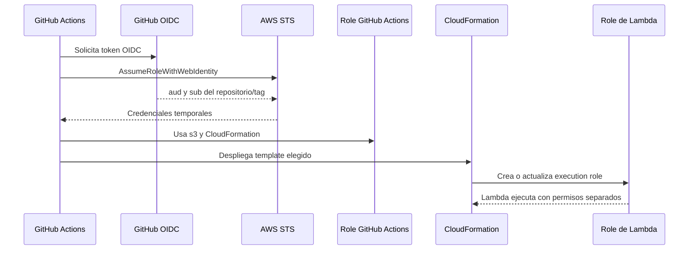

# Seguridad de Lambda CI/CD

Este documento explica qué protege el repositorio, cómo fluye cada identidad y qué riesgos
siguen siendo responsabilidad de quien administra AWS y GitHub.

## Principios

- El código, la configuración y el secreto son artefactos distintos.
- GitHub Actions no usa access keys estáticas.
- GitHub asume un role AWS mediante OIDC y tokens temporales.
- Lambda usa otro role, separado del role de GitHub.
- El secreto solo se consulta desde Secrets Manager.
- S3 permanece privado y los objetos se cifran en reposo.
- Ningún workflow crea automáticamente el proveedor OIDC, el bucket o el secreto.

## Flujo de identidades



El trust policy comprueba dos claims del token:

- `aud` debe ser `sts.amazonaws.com`.
- `sub` debe corresponder exactamente al repositorio configurado y a uno de estos tags:
  `direct-v*`, `api-v*`, `alb-v*`, `url-v*` o `event-v*`.

Un push normal, una pull request o un tag de otro repositorio no puede asumir ese role.

## Protección de S3

El bootstrap crea un bucket de artefactos con:

- Bloqueo de acceso público.
- Versioning habilitado.
- Cifrado por defecto SSE-S3.
- Rechazo de peticiones sin HTTPS mediante `aws:SecureTransport`.
- Rechazo de objetos sin `x-amz-server-side-encryption: AES256`.
- Role de GitHub limitado a `code/*` y `config/*`.

Los workflows suben los artefactos así:

```bash
aws s3 cp build/lambda-1.2.3.zip \
  s3://bucket/code/1.2.3.zip \
  --sse AES256

aws s3 cp config/example.json \
  s3://bucket/config/1.2.3.json \
  --sse AES256
```

La configuración no se copia dentro del ZIP. El secreto tampoco se copia al bucket.

Versioning permite volver a una versión anterior, pero también conserva objetos antiguos. Define
una lifecycle policy cuando tengas claro cuánto tiempo necesitas conservarlos y verifica que no
elimine la versión activa.

## Protección del secreto

Secrets Manager genera el secreto durante el bootstrap. El repositorio solo maneja `SECRET_ARN`:

- `SECRET_ARN` identifica el secreto, pero no contiene su valor.
- Lambda recibe el ARN como variable de entorno.
- La policy de ejecución permite únicamente `secretsmanager:GetSecretValue` sobre ese ARN.
- El handler devuelve solo metadatos seguros.
- Tests y smoke tests comprueban que el valor no aparece en respuestas ni logs.

Nunca pongas el valor del secreto en:

- Variables o secrets de GitHub.
- `config/example.json`.
- Ficheros `.env`.
- Fixtures, snapshots o payloads de prueba.
- Outputs de CloudFormation.
- Mensajes de log o argumentos de comandos.

## Separación de roles

### Role de GitHub Actions

Puede subir los artefactos a S3 y ejecutar el despliegue CloudFormation. Su trust policy está
ligada al repositorio y a los prefijos de tags del proyecto.

El role de GitHub no es el role que ejecuta la Lambda.

### Role de ejecución de Lambda

Solo necesita:

- Escritura de logs en el grupo de la función.
- `s3:GetObject` sobre el objeto de configuración desplegado.
- `secretsmanager:GetSecretValue` sobre el ARN del secreto.

No recibe permisos para subir objetos, modificar IAM ni desplegar CloudFormation.

## Modos HTTP

La elección del endpoint cambia la superficie pública:

| Modo | Exposición | Riesgo principal |
|---|---|---|
| Directo | No crea endpoint HTTP | Controlar quién tiene permiso `lambda:InvokeFunction` |
| API Gateway | El ejemplo crea endpoint público | Añadir authorizer, throttling y WAF antes de producción |
| ALB | El ejemplo usa ALB internet-facing y HTTP | Usar HTTPS, ACM, reglas y autenticación |
| Function URL | `AWS_IAM` por defecto; `NONE` es público | No usar `NONE` con datos reales |

El acceso público del ejemplo facilita la prueba, pero no es una configuración de producción.

## Riesgos residuales

- El role de GitHub puede desplegar templates del repositorio cuando el tag está autorizado.
  Protege los tags y limita quién puede publicar releases.
- Las variables de repositorio pueden cambiarse desde GitHub. Restringe quién administra Actions.
- El bootstrap mantiene algunos permisos de CloudFormation amplios para soportar los cinco
  templates. Revisa y acota `cloudformation:*` y `iam:PassRole` antes de usarlo en producción.
- SSE-S3 protege el almacenamiento, pero SSE-KMS aporta control de claves, auditoría y separación
  adicional si la organización lo necesita.
- Los logs pueden revelar datos sensibles si se añade logging indiscriminado al handler.

## Respuesta ante exposición

1. Considera comprometido cualquier secreto que aparezca en un log, commit, artifact o output.
2. Rota el secreto en Secrets Manager inmediatamente.
3. Revisa CloudTrail, CloudWatch Logs, GitHub Actions y versiones de S3.
4. Revoca o actualiza el role OIDC si sospechas del workflow o del repositorio.
5. Elimina el valor del historial Git y utiliza las herramientas de revocación de GitHub.
6. No publiques el valor en una issue o en una conversación.

Consulta [SECURITY.md](../SECURITY.md) para el procedimiento breve de reporte y revocación.

## Checklist antes de producción

- [ ] El bootstrap se ejecutó desde una cuenta y región revisadas.
- [ ] Los tags están protegidos en GitHub.
- [ ] Solo mantenedores autorizados pueden modificar workflows y variables.
- [ ] API Gateway, ALB o Function URL tienen autenticación adecuada.
- [ ] El ALB usa HTTPS y un certificado ACM si se expone públicamente.
- [ ] Se ha decidido la retención de versiones S3.
- [ ] Se ha revisado CloudTrail y la política de lifecycle.
- [ ] Se ha probado la rotación del secreto.
- [ ] No aparecen secretos en logs, ZIPs, outputs ni documentación.
